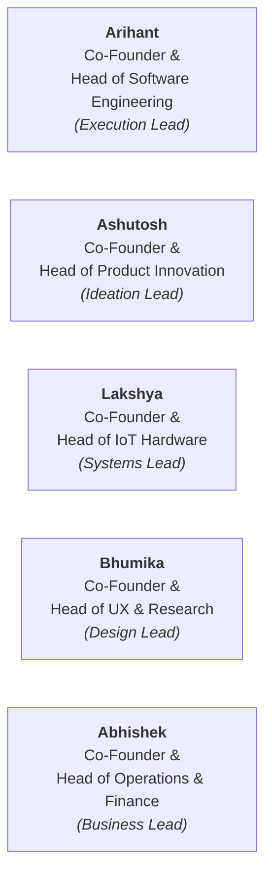

# PillVox — Connected Elderly Care & Smart Medication Management System 🏥💊

> **"Because care should always feel personal"**  
> An integrated HealthTech ecosystem connecting remote family caregivers with elderly loved ones through a **dual-portal web application** and an **IoT sensor-monitored smart medicine box**.

[](https://caresure-he3m.vercel.app)
[](https://github.com/arrieejain3149/Pillvox.git)
[](https://nextjs.org)
[](https://nodejs.org)
[](https://www.mongodb.com/atlas)
[](https://threejs.org)

---

## 🌟 The Problem We Solve

According to the World Health Organization (WHO), **over 50% of patients with chronic illnesses fail to take their medications as prescribed**. For senior citizens (aged 65+), this crisis is amplified by **polypharmacy**—taking 4 to 10 different pills daily across specific meal timings:

* ⚠️ **Accidental Double-Dosing & Omissions**: Cognitive fatigue causes seniors to forget whether a dose was taken, risking toxicity or health decline.
* 😰 **The "Sandwich Generation" Anxiety**: Working adult children living in different cities carry constant stress, relying on intrusive daily check-in calls that feel like policing.
* 📱 **Over-Complicated Technology**: Most mobile reminder apps are crammed with tiny fonts, complex menus, and ads that frustrate elderly users.
* 🚨 **Emergency Information Blind Spots**: During a fall or sudden medical episode, first responders have zero immediate visibility into the senior's active medications, drug allergies, or emergency contacts.

---

## 💡 The PillVox Solution

PillVox breaks the vicious cycle by creating a closed-loop healthcare bridge:

```
┌────────────────────────────────────────────────────────────────────────┐
│                        THE PILLVOX ECOSYSTEM                           │
│                                                                        │
│  [CAREGIVER PORTAL] ──(Schedules & OCR)──► [PILLVOX CLOUD PLATFORM]   │
│         ▲                                             │                │
│         │ (Real-time adherence alerts)                ▼                │
│  [REMOTE NOTIFICATIONS] ◄── [SMART MEDICINE BOX & SENIOR PORTAL]       │
│                             (LED guidance + physical sensor triggers)  │
└────────────────────────────────────────────────────────────────────────┘
```

### 🔑 Core Features

1. **Dual-Portal Synchronized Architecture**:
   * **Caregiver Command Center (`/dashboard`)**: Remote management of multiple elderly family members, dosage schedules, adherence streaks, and real-time missed-dose alerts.
   * **Senior Patient Portal (`/patient/dashboard`)**: High-contrast, large-font interface stripped of cognitive clutter. Displays straightforward meal cues (*"Morning - After Breakfast"*) with tactile **"Mark as Taken"** confirmations.
2. **AI Prescription OCR Scanner (`/patients/[id]/medications/add`)**:
   * Caregivers snap a photo of a doctor's printed or handwritten prescription.
   * Built-in OCR engine automatically extracts medication names, dosages, and daily frequencies, eliminating manual typing errors.
3. **Emergency QR Medical Pass (`/patients/[id]/medical-card`)**:
   * Dynamic QR code generated for every senior.
   * Any paramedic or bystander can scan the code with a standard smartphone to immediately view blood group, drug allergies, pre-existing conditions, and guardian phone numbers without needing an app install.
4. **Interactive 3D Hardware Blueprint (`/hardware`)**:
   * Real-time Three.js 3D interactive model of the **PillVox Smart Medicine Box**.
   * Demonstrates 8 modular pill compartments, individual micro-switch sensors, main lid hall sensors, and Wi-Fi motherboard.
5. **Dignified Warm Beige & Espresso Design System**:
   * Unified palette of Warm Beige (`#faf6f0`), Soft Cream (`#ede0d0`), and Espresso Brown (`#4a2e1e`)—deliberately replacing cold clinical blues with emotional warmth, comfort, and legibility.

---

## 👥 Co-Founding Council & Democratic Governance

PillVox operates under a **Flat Co-Founding Council** of 5 equal partners (20% voting power each), representing balanced leadership across essential business disciplines:



### 13-Specialist Startup Organizational Structure:
* **Software Engineering & Data Security (Led by Arihant)**: 3 Full-Stack Web/Mobile Developers & 1 Cybersecurity Specialist (HIPAA/DPDP health data encryption).
* **Product Innovation & AI (Led by Ashutosh)**: 1 AI Engineer (Prescription OCR & predictive adherence) & 1 UX Designer (Design system).
* **IoT Hardware & Systems (Led by Lakshya)**: 2 Firmware / Embedded IoT Engineers (ESP32 smart box telemetry).
* **UX Design & Customer Success (Led by Bhumika)**: 1 Customer Service Manager (Senior onboarding & user research feedback).
* **Business Operations & Finance (Led by Abhishek)**: 1 Finance Manager, 1 Marketing Manager, and 1 HR Manager.

---

## 🛠️ Architecture & Tech Stack

### Frontend (`/frontend`)
* **Framework**: Next.js 16 (App Router) & React 19
* **Styling**: Tailwind CSS v4
* **3D Interactive Hardware**: Three.js, `@react-three/fiber`, `@react-three/drei`, GSAP
* **Adherence Charts**: Recharts
* **Emergency QR Engine**: `react-qr-code`
* **HTTP Client**: Axios with JWT interceptors
* **Deployment**: Vercel

### Backend (`/backend`)
* **Runtime**: Node.js & Express.js
* **Database**: MongoDB with Mongoose ODM
* **Authentication**: JWT & Bcrypt (Dual roles: Caregiver & Senior Patient)
* **OCR Document Scanner**: Tesseract.js (Optical Character Recognition)
* **IoT Hardware Integration**: REST Webhooks for ESP32 / Arduino Uno smart pill box

---

## 🚀 Local Development Quick Start

### 1. Prerequisites
* **Node.js**: v18+ (v20+ recommended)
* **MongoDB**: Local MongoDB or free [MongoDB Atlas](https://www.mongodb.com/cloud/atlas) cluster.

### 2. Run Both Frontend & Backend Concurrently
From the root project directory:
```bash
npm run dev
```

This concurrently fires up:
* 🌐 **Frontend Application**: `http://localhost:3000`
* ⚙️ **Backend REST API**: `http://localhost:5000` (`http://localhost:5000/api/health`)

---

## 📁 Repository Directory Structure

```
Pillvox/
├── backend/                  # Express REST API & Mongoose models
│   ├── config/               # Database connection & setup
│   ├── middleware/           # Auth & admin access guards
│   ├── models/               # Caregiver, Patient, Dose, Device, Alert schemas
│   ├── routes/               # API endpoints (auth, patients, medications, etc.)
│   └── server.js             # Main backend entrypoint
├── frontend/                 # Next.js 16 App Router UI
│   ├── app/                  # Pages: /dashboard, /patient, /hardware, etc.
│   ├── components/           # Navbar, 3D Canvas, Modals, Guards, Logo
│   ├── lib/                  # Axios API client & helpers
│   └── public/               # 3D GLB assets & static images
├── package.json              # Orchestrates concurrent full-stack dev scripts
└── README.md
```

---

## 📜 Academic Attribution

* **Course**: Essentials of Business Management (EBM)
* **Startup Theme**: HealthTech (Domain #3)
* **Live Webapp**: [https://caresure-he3m.vercel.app](https://caresure-he3m.vercel.app)
* **GitHub Repository**: [https://github.com/arrieejain3149/Pillvox.git](https://github.com/arrieejain3149/Pillvox.git)
